<picture>
  <source media="(max-width: 600px) and (prefers-color-scheme: dark)" srcset="assets/hero-narrow-dark.svg">
  <source media="(max-width: 600px)" srcset="assets/hero-narrow-light.svg">
  <source media="(prefers-color-scheme: dark)" srcset="assets/hero-dark.svg">
  
</picture>

<picture>
  <source media="(max-width: 600px) and (prefers-color-scheme: dark)" srcset="assets/divider-narrow-about-dark.svg">
  <source media="(max-width: 600px)" srcset="assets/divider-narrow-about-light.svg">
  <source media="(prefers-color-scheme: dark)" srcset="assets/divider-about-dark.svg">
  
</picture>

I'm a Computer Science student at **UET Taxila** and a freelance developer who builds whole products, from the interface down to the protocol. I founded [Havlen](https://havlen-seven.vercel.app/), an AI receptionist that answers customers on WhatsApp and the web in English or Roman Urdu, books real appointments and hands over to staff when it should. Growing it is what I'm doing now.

Most of my work is web apps, Electron desktop apps, Android apps in Kotlin, and the Python and Node.js backends behind them. I build by vibe coding with AI agents, then testing in the real world until it holds up: no internet, an old Windows PC, a printer that only speaks USB, and a customer who will hold a ruler against the result. I care about privacy by default, and about getting it right to the millimetre.

<picture>
  <source media="(max-width: 600px) and (prefers-color-scheme: dark)" srcset="assets/divider-narrow-work-dark.svg">
  <source media="(max-width: 600px)" srcset="assets/divider-narrow-work-light.svg">
  <source media="(prefers-color-scheme: dark)" srcset="assets/divider-work-dark.svg">
  
</picture>

<a href="https://havlen-seven.vercel.app/"><picture>
  <source media="(max-width: 600px) and (prefers-color-scheme: dark)" srcset="assets/card-narrow-havlen-dark.svg">
  <source media="(max-width: 600px)" srcset="assets/card-narrow-havlen-light.svg">
  <source media="(prefers-color-scheme: dark)" srcset="assets/card-havlen-dark.svg">
  
</picture></a>
<a href="https://github.com/hafeee44-lab/Roshni"><picture>
  <source media="(max-width: 600px) and (prefers-color-scheme: dark)" srcset="assets/card-narrow-roshni-dark.svg">
  <source media="(max-width: 600px)" srcset="assets/card-narrow-roshni-light.svg">
  <source media="(prefers-color-scheme: dark)" srcset="assets/card-roshni-dark.svg">
  
</picture></a>
<a href="https://github.com/hafeee44-lab/PrintBridge"><picture>
  <source media="(max-width: 600px) and (prefers-color-scheme: dark)" srcset="assets/card-narrow-printbridge-dark.svg">
  <source media="(max-width: 600px)" srcset="assets/card-narrow-printbridge-light.svg">
  <source media="(prefers-color-scheme: dark)" srcset="assets/card-printbridge-dark.svg">
  
</picture></a>
<a href="https://play.google.com/store/apps/details?id=com.hafi.locationalarm"><picture>
  <source media="(max-width: 600px) and (prefers-color-scheme: dark)" srcset="assets/card-narrow-gpsalarm-dark.svg">
  <source media="(max-width: 600px)" srcset="assets/card-narrow-gpsalarm-light.svg">
  <source media="(prefers-color-scheme: dark)" srcset="assets/card-gpsalarm-dark.svg">
  
</picture></a>
<a href="https://lift-workouts-havlen.vercel.app/"><picture>
  <source media="(max-width: 600px) and (prefers-color-scheme: dark)" srcset="assets/card-narrow-lift-dark.svg">
  <source media="(max-width: 600px)" srcset="assets/card-narrow-lift-light.svg">
  <source media="(prefers-color-scheme: dark)" srcset="assets/card-lift-dark.svg">
  
</picture></a>
<a href="https://github.com/haiderimran019/Solvane"><picture>
  <source media="(max-width: 600px) and (prefers-color-scheme: dark)" srcset="assets/card-narrow-solvane-dark.svg">
  <source media="(max-width: 600px)" srcset="assets/card-narrow-solvane-light.svg">
  <source media="(prefers-color-scheme: dark)" srcset="assets/card-solvane-dark.svg">
  
</picture></a>
<a href="https://github.com/hafeee44-lab/duplex"><picture>
  <source media="(max-width: 600px) and (prefers-color-scheme: dark)" srcset="assets/card-narrow-duplex-dark.svg">
  <source media="(max-width: 600px)" srcset="assets/card-narrow-duplex-light.svg">
  <source media="(prefers-color-scheme: dark)" srcset="assets/card-duplex-dark.svg">
  
</picture></a>
<a href="https://github.com/hafeee44-lab/quickprint"><picture>
  <source media="(max-width: 600px) and (prefers-color-scheme: dark)" srcset="assets/card-narrow-quickprint-dark.svg">
  <source media="(max-width: 600px)" srcset="assets/card-narrow-quickprint-light.svg">
  <source media="(prefers-color-scheme: dark)" srcset="assets/card-quickprint-dark.svg">
  
</picture></a>

See them live: <a href="https://havlen-seven.vercel.app/">Havlen</a> · <a href="https://github.com/hafeee44-lab/Roshni/releases/latest">Roshni APK</a> · <a href="https://play.google.com/store/apps/details?id=com.hafi.locationalarm">GPS Alarm on Google Play</a> · <a href="https://lift-workouts-havlen.vercel.app/">Lift</a> · <a href="https://haiderimran019.github.io/Solvane/">Solvane</a> · <a href="https://cnic-duplex.vercel.app">Duplex</a>

<picture>
  <source media="(max-width: 600px) and (prefers-color-scheme: dark)" srcset="assets/divider-narrow-hackathons-dark.svg">
  <source media="(max-width: 600px)" srcset="assets/divider-narrow-hackathons-light.svg">
  <source media="(prefers-color-scheme: dark)" srcset="assets/divider-hackathons-dark.svg">
  
</picture>

<a href="https://github.com/hafeee44-lab/aicon26-er-dashboard"><picture>
  <source media="(max-width: 600px) and (prefers-color-scheme: dark)" srcset="assets/card-narrow-ercommand-dark.svg">
  <source media="(max-width: 600px)" srcset="assets/card-narrow-ercommand-light.svg">
  <source media="(prefers-color-scheme: dark)" srcset="assets/card-ercommand-dark.svg">
  
</picture></a>
<a href="https://github.com/hafeee44-lab/Nascon-ijtemai-kaavish"><picture>
  <source media="(max-width: 600px) and (prefers-color-scheme: dark)" srcset="assets/card-narrow-nascon-dark.svg">
  <source media="(max-width: 600px)" srcset="assets/card-narrow-nascon-light.svg">
  <source media="(prefers-color-scheme: dark)" srcset="assets/card-nascon-dark.svg">
  
</picture></a>

Try the <a href="https://aicon26-er-dashboard-taupe.vercel.app">ER Command live demo</a>.

<picture>
  <source media="(max-width: 600px) and (prefers-color-scheme: dark)" srcset="assets/divider-narrow-toolbox-dark.svg">
  <source media="(max-width: 600px)" srcset="assets/divider-narrow-toolbox-light.svg">
  <source media="(prefers-color-scheme: dark)" srcset="assets/divider-toolbox-dark.svg">
  
</picture>

<picture>
  <source media="(max-width: 600px) and (prefers-color-scheme: dark)" srcset="assets/toolbox-narrow-dark.svg">
  <source media="(max-width: 600px)" srcset="assets/toolbox-narrow-light.svg">
  <source media="(prefers-color-scheme: dark)" srcset="assets/toolbox-dark.svg">
  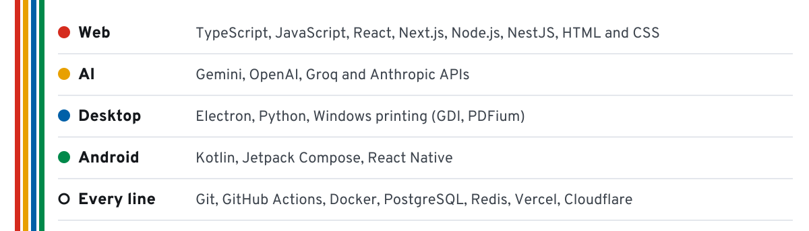
</picture>

<picture>
  <source media="(max-width: 600px) and (prefers-color-scheme: dark)" srcset="assets/divider-narrow-activity-dark.svg">
  <source media="(max-width: 600px)" srcset="assets/divider-narrow-activity-light.svg">
  <source media="(prefers-color-scheme: dark)" srcset="assets/divider-activity-dark.svg">
  
</picture>

<picture>
  <source media="(prefers-color-scheme: dark)" srcset="https://raw.githubusercontent.com/hafeee44-lab/hafeee44-lab/output/snake-dark.svg">
  
</picture>

<picture>
  <source media="(max-width: 600px) and (prefers-color-scheme: dark)" srcset="assets/contact-narrow-dark.svg">
  <source media="(max-width: 600px)" srcset="assets/contact-narrow-light.svg">
  <source media="(prefers-color-scheme: dark)" srcset="assets/contact-dark.svg">
  
</picture>

<a href="mailto:hafeee44@gmail.com"><picture>
  <source media="(max-width: 600px) and (prefers-color-scheme: dark)" srcset="assets/board-narrow-email-dark.svg">
  <source media="(max-width: 600px)" srcset="assets/board-narrow-email-light.svg">
  <source media="(prefers-color-scheme: dark)" srcset="assets/board-email-dark.svg">
  
</picture></a>
<a href="https://www.linkedin.com/in/muhammad-hafi-b37193222/"><picture>
  <source media="(max-width: 600px) and (prefers-color-scheme: dark)" srcset="assets/board-narrow-linkedin-dark.svg">
  <source media="(max-width: 600px)" srcset="assets/board-narrow-linkedin-light.svg">
  <source media="(prefers-color-scheme: dark)" srcset="assets/board-linkedin-dark.svg">
  
</picture></a>

<a href="mailto:hafeee44@gmail.com">hafeee44@gmail.com</a> · <a href="https://www.linkedin.com/in/muhammad-hafi-b37193222/">LinkedIn</a>

